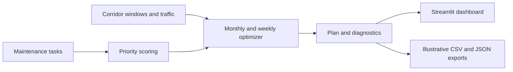

<div align="center">

# 🚆 RailOpt

### Automatic Railway Maintenance Block Planning

Coordinate maintenance work across **Engineering**, **Signal & Telecom**, and **Traction** with optimized corridor-block recommendations.


</div>

> [!IMPORTANT]
> **RailOpt is a research prototype, not an operational railway system.** The current workflow uses synthetic data and expert-set assumptions. It is not connected to live TMS, SMMS, TDMS, COA, or BDMS systems. Its schedules are recommendations only and must not replace railway safety procedures or official approval.

## 📚 Contents

- [Overview](#-overview)
- [How it works](#-how-it-works)
- [Features](#-features)
- [Project structure](#-project-structure)
- [Getting started](#-getting-started)
- [Run the planner](#-run-the-planner)
- [Dashboard](#-dashboard)
- [Outputs](#-outputs)
- [Tests](#-tests)
- [Data and assumptions](#-data-and-assumptions)

## 🎯 Overview

Railway maintenance blocks are requested by different departments, while corridor availability and train traffic constrain when work can take place. RailOpt explores how a shared planning process can prioritize maintenance and coordinate work across departments.

The planner takes maintenance tasks, corridor windows, and traffic-impact estimates and produces a **monthly task-to-week plan** refined into **weekly block schedules**. A Streamlit dashboard lets users inspect the recommendations, explore an emergency-task scenario, review unscheduled work, and export illustrative block requests.

### Departments

| Code | Department |
|:---|:---|
| `ENGG` | Engineering |
| `S&T` | Signal & Telecom |
| `TRD` | Traction |

## ⚙️ How it works



1. **Prepare inputs** — use the common task schema, corridor-window data, and priority scores.
2. **Prioritize tasks** — combine criticality, urgency, predicted failure risk, and traffic impact.
3. **Optimize blocks** — assign tasks to feasible windows subject to capacity, crew, power-block, and safety constraints.
4. **Review results** — inspect the weekly/monthly plan, KPIs, unscheduled-task reasons, and diagnostics in the dashboard.
5. **Export recommendations** — download illustrative BDMS-style block requests and work-item lists for review.

## ✨ Features

- **Maintenance prioritization** using weighted criticality, urgency, failure-risk, and traffic-impact components.
- **Monthly and weekly planning** with a monthly task-to-week assignment refined into weekly corridor-window schedules.
- **Multi-department coordination** with crews working in parallel inside a block, shared setup time, and an S&T/TRD separation rule.
- **Constraint-aware scheduling** for corridor availability, window duration, power-block needs, daily block limits, and crew availability.
- **Planning diagnostics** for unscheduled tasks, extended-block needs, workload, capacity, and objective consistency.
- **Manual-baseline comparison** against a simulated decentralized-planning process.
- **Emergency what-if analysis** to preview the effect of inserting a high-priority task into a selected week.
- **CSV/JSON exports** in an illustrative format pending confirmation of the real BDMS schema.

## 🗂️ Project structure

```text
.
├── DATA/                         # Inputs used by the current planner
│   ├── coa_corridor_windows.csv
│   ├── sections.csv
│   ├── tasks_common_schema.csv
│   └── traffic_forecast.csv
├── outputs/
│   └── prioritized_tasks.csv     # Priority scores consumed by the planner
├── Block_planner/
│   ├── app.py                    # Streamlit dashboard
│   ├── horizons.py               # Monthly planner and weekly refinement
│   ├── optimizer.py              # Scheduling model and constraints
│   ├── priority.py               # Priority scoring and synthetic risk model
│   ├── data_gen.py               # Synthetic data generator
│   ├── baseline.py               # Simulated manual-planning baseline
│   ├── metrics.py                # KPI calculations and result loading
│   ├── whatif.py                 # Emergency-task impact analysis
│   ├── bdms_export.py            # Illustrative CSV/JSON export helpers
│   ├── outputs/                  # Generated plans and diagnostics
│   └── test_*.py                 # Unit and integration tests
├── Backups/                      # Earlier planning-stage files
├── Docs/                         # Project documents
├── requirements.txt
└── README.md
```

## 🚀 Getting started

### Requirements

- Python 3 (Python 3.10 or later recommended)
- The packages listed in [`requirements.txt`](requirements.txt)

### Install dependencies

Run these commands from the **repository root**:

```powershell
python -m venv .venv
.\.venv\Scripts\Activate.ps1
python -m pip install --upgrade pip
python -m pip install -r requirements.txt
```

If PowerShell prevents environment activation, either allow activation according to your local policy or invoke the environment's Python directly:

```powershell
.\.venv\Scripts\python.exe -m pip install -r requirements.txt
```

### Check planner inputs

Before running the planner, make sure these files exist:

| File | Purpose |
|:---|:---|
| `DATA\tasks_common_schema.csv` | Normalized maintenance-task input |
| `DATA\coa_corridor_windows.csv` | Available block windows and traffic impact |
| `outputs\prioritized_tasks.csv` | Task priority scores and tiers |

## ▶️ Run the planner

From the repository root, run:

```powershell
python .\Block_planner\horizons.py --no-ablation
```

The planner writes its schedule, summaries, and diagnostics under `Block_planner\outputs\`. Use the command-line help to see planning options:

```powershell
python .\Block_planner\horizons.py --help
```

To start the dashboard after generating the planner outputs:

```powershell
python -m streamlit run .\Block_planner\app.py
```

Streamlit prints a local URL in the terminal. Open that URL in a browser. The dashboard also provides a control to rerun the planner with selected settings.

## 📊 Dashboard

The dashboard is split into pages, grouped in the sidebar. Each page opens with a one-line explanation, and the sidebar has a **glossary** of railway and planning terms.

| Group | Page | What you can inspect |
|:---|:---|:---|
| Plan | **Overview** | Headline KPIs, key takeaways and the full comparison with the simulated manual baseline |
| Plan | **Block calendar** | Gantt view of blocks filtered by plan, week, department and section, with selection KPIs |
| Plan | **Weekly & monthly view** | Per-week cards, department workload, section heatmap and monthly-plan realization |
| Scenarios | **Emergency what-if** | Impact of adding an emergency task, with a recommended week |
| Scenarios | **Rolling re-plan** | Stable vs full vs patch re-planning on saved and custom events |
| Review | **Unscheduled work** | Why tasks were left out, in plain language, with filters and recommended actions |
| Review | **Export requests** | Illustrative block-request and work-item CSV/JSON downloads |

The theme lives in `.streamlit/config.toml` (read when Streamlit is started from the repository root) and the shared styling and labels live in `Block_planner/ui.py`.

## 📦 Outputs

The planning run produces files in `Block_planner\outputs\`, including:

| Output | Description |
|:---|:---|
| `block_plan_4w.csv` | Scheduled tasks and their assigned blocks |
| `block_summary_4w.csv` | Summary of opened blocks |
| `monthly_plan.csv` | Monthly task-to-week assignments |
| `monthly_realization.csv` | Comparison of monthly assignments and weekly results |
| `horizon_summary.csv` | Weekly planning KPIs |
| `unscheduled_final.csv` | Tasks not scheduled and diagnostic reasons |
| `needs_extended_block_4w.csv` | Tasks needing longer or otherwise unavailable blocks |
| `capacity_diagnosis.csv` | Eligible work and capacity diagnostics |
| `workload_profile.csv` | Workload by week |
| `objective_audit.csv` | Recomputed objective compared with solver results |

## 🧪 Tests

Run the test suite from the repository root:

```powershell
python -m unittest discover -s .\Block_planner -p "test_*.py" -v
```

Some integration tests rely on the prepared CSV inputs and generated planner outputs. Tests that use small in-code fixtures can run independently.

## 📝 Data and assumptions

The project includes early-stage synthetic data and priority utilities, but their default paths are not wired directly into the current planner workflow:

- `Block_planner\data_gen.py` writes generated inputs to `Block_planner\data\`.
- `Block_planner\priority.py` reads from and writes to `Block_planner\data\` and `Block_planner\outputs\`.
- The current planner reads tasks and corridor windows from the repository-level `DATA\` directory and priority scores from repository-level `outputs\prioritized_tasks.csv`.

Therefore, running the early-stage utilities alone does **not** refresh the inputs used by the planner. Place or prepare the required CSVs in the locations listed above before running `horizons.py`.

Keep these limitations in mind when interpreting results:

- The maintenance records, corridor windows, train-impact estimates, and failure history are synthetic.
- The failure-risk model is trained on generated labels; its performance is not evidence of accuracy on real railway data.
- Priority and objective weights are expert-set modelling choices, not calibrated operational values.
- The “manual” baseline is a simulation based on stated assumptions, not measured historical performance.
- “Task-days past due” is a lateness proxy, not measured asset downtime or train-delay minutes.
- The BDMS export layout is illustrative because the real BDMS schema is unavailable.
- All recommendations require review by authorized railway personnel; the prototype does not replace operational approvals or safety rules.

For project motivation and the expected solution, see [`Docs/Problem Statement.txt`](Docs/Problem%20Statement.txt).
